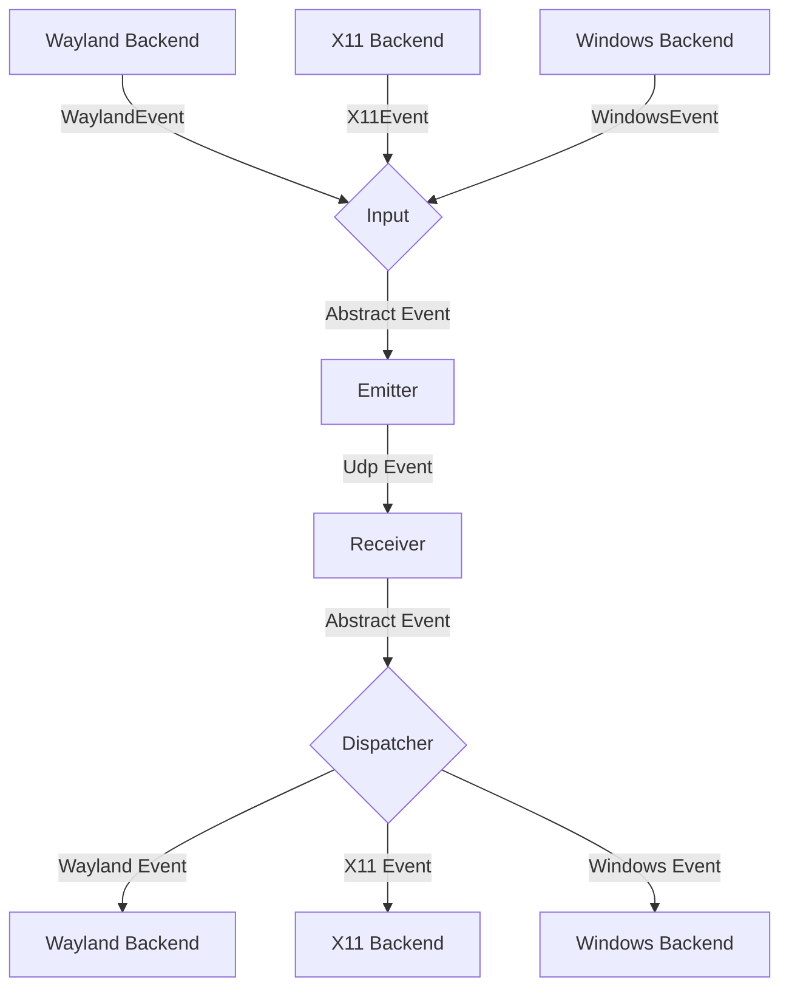
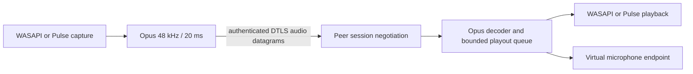
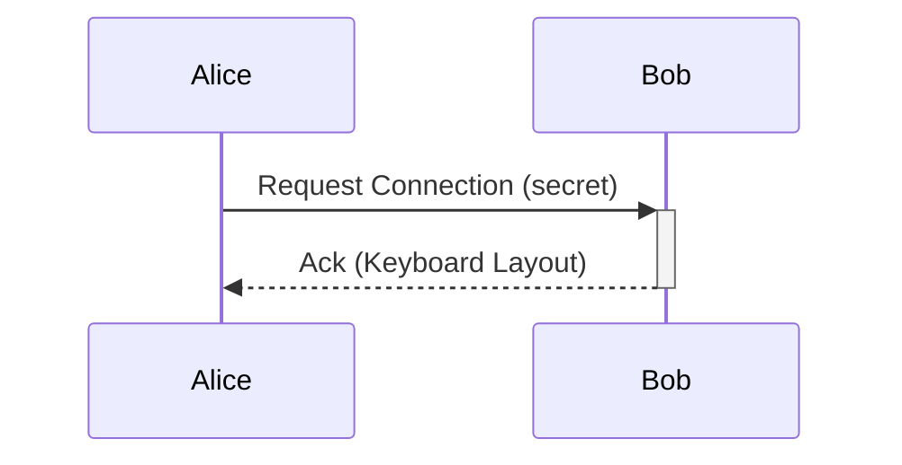

# General Software Architecture

## Events

Each instance of lan-mouse can emit and receive events, where
an event can be mouse, keyboard, clipboard, or audio data.

The general Architecture is shown in the following flow chart:

### Audio sharing

The audio path is separate from input-event emulation:

Each configured peer announces one role: `Off`, `Send`, or `Receive`. A peer
starts capture or playback only for a complementary role announcement. System
audio and microphone audio use separate Opus tracks and retain independent
sequence numbers. Per-peer workers and queues are bounded, and disconnects or
role changes stop their workers and clear pending frames. Audio media is
accepted only from the authenticated connection associated with one unambiguous
configured peer address.

The shared Rust audio crate contains the Opus codec and playout logic. Linux
uses PulseAudio APIs and creates a temporary Pulse-compatible virtual source
for received microphone audio. Windows uses shared-mode WASAPI loopback,
microphone capture, and playback. The user-mode bridge targets the IOCTL
contract in `audio-driver/windows/lan_mouse_mic_ioctl.h`; the WDM/WaveRT driver
that exposes the Windows recording endpoint remains to be implemented.

### Input
The input component is responsible for translating inputs from a given backend
to a standardized format and passing them to the event emitter.

### Emitter
The event emitter serializes events and sends them over the network
to the correct client.

### Receiver
The receiver receives events over the network and deserializes them into
the standardized event format.

### Dispatcher
The dispatcher component takes events from the event receiver and passes them
to the correct backend corresponding to the type of client.

## Requests

// TODO this currently works differently

Aside from events, requests can be sent via a simple protocol.
For this, a simple tcp server is listening on the same port as the udp
event receiver and accepts requests for connecting to a device or to
request the keymap of a device.

## Problems

### Windows crash diagnostics

Set `LAN_MOUSE_LOG_FILE` to a writable file path before launching Lan Mouse.
The GUI and daemon append their logs there, including Rust panic messages,
source locations, and backtraces even when the app runs without a console.
`LAN_MOUSE_LOG_LEVEL` must allow `error` messages (the default does).
Keep the matching executable and PDB when diagnosing release backtraces;
stripped builds may contain addresses instead of function names.

The Windows capture worker creates its Win32 message queue before publishing
its thread ID. Without that ordering, activating a client immediately after
startup can fail with `ERROR_INVALID_THREAD_ID` from `PostThreadMessageW`.

The general Idea is to have a bidirectional connection by default, meaning
any connected device can not only receive events but also send events back.

This way when connecting e.g. a PC to a Laptop, either device can be used
to control the other.

It needs to be ensured, that whenever a device is controlled the controlled
device does not transmit the events back to the original sender.
Otherwise events are multiplied and either one of the instances crashes.

To keep the implementation of input backends simple this needs to be handled
on the server level.

## Device State - Active and Inactive
To solve this problem, each device can be in exactly two states:

Either events are sent or received.

This ensures that
- a) Events can never result in a feedback loop.
- b) As soon as a virtual input enters another client, lan-mouse will stop receiving events,
which ensures clients can only be controlled directly and not indirectly through other clients.

